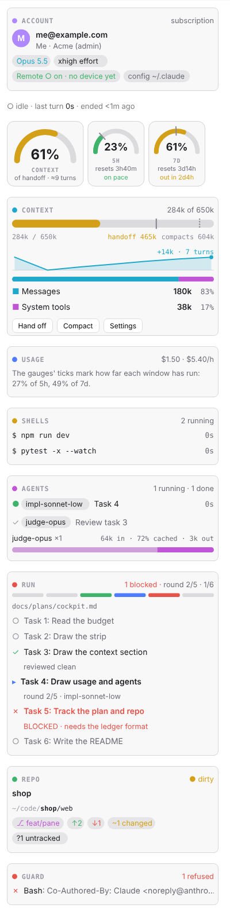
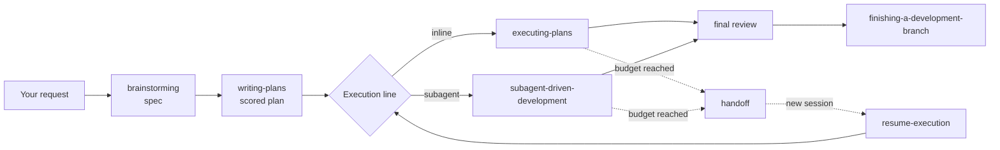
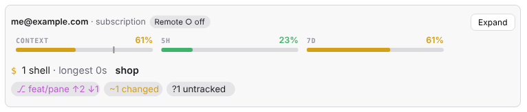

# darkraise-ai-plugins

[](https://github.com/darkraise/darkraise-ai-plugins/actions/workflows/validate.yml)
[](LICENSE)


A plugin marketplace for [Claude Code](https://github.com/anthropics/claude-code)
and [Codex](https://github.com/openai/codex), published as `darkraise`. It
carries a spec-to-merge development workflow, a session cockpit, an
account-aware status line and coding-agent skills for two design systems.

<p align="center">
  <picture>
    <source media="(prefers-color-scheme: dark)" srcset="docs/images/cockpit-flight-deck-dark.png">
    
  </picture>
</p>

## Plugins

| Plugin | What it does | Claude Code | Codex |
| --- | --- | :---: | :---: |
| [dr-forge](plugins/dr-forge/README.md) | Turns a request into a reviewed spec, a scored plan and a tiered execution run. On Claude Code it adds the cockpit pane, Discord notifications and an attribution guard. | ✓ | ✓ (no cockpit) |
| [dr-status](plugins/dr-status/README.md) | A status line with git detail and usage meters, framed in the color of the Claude account. | ✓ | |
| [dcc-darkraise-ui](plugins/dcc-darkraise-ui/README.md) | Teaches agents to write idiomatic darkraise-ui code. | ✓ | ✓ |
| [dcc-darkraise-win32ui](plugins/dcc-darkraise-win32ui/README.md) | Teaches agents to write idiomatic Darkraise.Win32UI code. | ✓ | ✓ |

## Install

### Claude Code

```text
/plugin marketplace add darkraise/darkraise-ai-plugins
/plugin install dr-forge@darkraise
```

The other plugins install the same way (`dr-status@darkraise`,
`dcc-darkraise-ui@darkraise`, `dcc-darkraise-win32ui@darkraise`). Start a new
session, or run `/reload-plugins`, afterwards. An installed copy stays at the
version it was installed at; take a new release with
`claude plugin update <plugin>@darkraise`.

Disable the upstream `superpowers`, `dcc-superpower-companions` and
`andrej-karpathy-skills` plugins, and the earlier `dr-superpowers` and
`dr-cockpit`, before you enable `dr-forge`: same-named skills in two enabled
plugins can trigger twice.

### Codex

```text
codex plugin marketplace add https://github.com/darkraise/darkraise-ai-plugins.git
codex plugin list --marketplace darkraise --available
codex plugin add dr-forge@darkraise
```

Register the repository root (its Git URL or a local checkout's absolute path),
not the catalog file: Codex 0.153.4's CLI rejects direct catalog-file
registration, and root discovery selects the dedicated Codex catalog
(`.agents/plugins/marketplace.json`). That catalog lists `dr-forge` and the two
UI plugins; `dr-status` is Claude Code only. On Codex, dr-forge uses the
client's native agent tools; see
[native-codex.md](plugins/dr-forge/reference/native-codex.md).

### Requirements

dr-forge needs Bash, Git and `jq` (on Windows, Git for Windows provides Bash).
The cockpit is built against Claude Code 2.1.295 to 2.1.296; the mod API it
uses is early access and may change between releases.

## dr-forge in brief

dr-forge is a standalone fork of
[superpowers](https://github.com/obra/superpowers) 6.3.0. A strong model plans,
cheaper implementers execute each task literally, and one strong judge seat
makes every judgment call. Its skills fire on their own: a `SessionStart` hook
loads the routing rules, so you describe what you want and the right skill takes
over. You can also name one, for example "use dr-forge:brainstorming".



A feature, start to finish:

1. **Describe the change.** "Add CSV export to the reports page." `brainstorming`
   asks clarifying questions one at a time, proposes approaches and writes a
   spec under `docs/forge/specs/`.
2. **Approve the spec.** `writing-plans` turns it into a plan under
   `docs/forge/plans/`. Each task is scored on four axes (files, spec
   completeness, coupling, risk), and the score picks its implementer, such as
   `impl-sonnet-low` or `impl-opus-high`. `plan-lint` checks the plan and a judge
   reviews it before it is saved. Saving a plan ends the session.
3. **Start a fresh session and say "resume".** `resume-execution` hands over to
   the mode the plan's `**Execution:**` line names: inline, where the session
   implements the tasks itself, or subagent, where each task goes to its
   implementer and is reviewed against scored criteria.
4. **Let it run.** Progress goes to `.forge/sdd/<plan>/progress.md`. A
   whole-branch review follows the last task, then
   `finishing-a-development-branch` offers to merge, open a pull request, keep
   the branch or wait.

Every request re-reads the whole context, so dr-forge prints a budget line
before each task and review and hands off to a fresh session when the budget is
reached. Other skills include `project-status`, `planning-a-product`,
`systematic-debugging`, `running-gates` and `test-simplifier`. The
[dr-forge README](plugins/dr-forge/README.md) covers the scoring rubric, the
agent roster, the escalation ladder, parallel waves, the Codex executor lane,
the settings and the cockpit in full.

## The cockpit

On Claude Code, dr-forge ships a cockpit: a mod, not a set of skills, so it
costs the model no context. It shows a long session at a glance: context
against its handoff budget, usage limits with forecasts, running shells and
subagents, the dr-forge run, and the repository. It can post to Discord when a
turn needs you, and its attribution guard keeps AI attribution out of your
commits and pull requests. It opens by itself once the terminal is 144 columns
wide, `/cockpit` opens it at any width, and **Minimize** folds it into a
two-line band above the prompt.

<p align="center">
  <picture>
    <source media="(prefers-color-scheme: dark)" srcset="docs/images/cockpit-band-dark.png">
    
  </picture>
</p>

See the [cockpit section](plugins/dr-forge/README.md#cockpit) and
[settings](plugins/dr-forge/README.md#settings) of the dr-forge README.

## Upgrading

Releases are versioned per plugin. Renamed plugins, retired plugins and
re-registering the marketplace are covered in [docs/migration.md](docs/migration.md);
dr-forge's own steps are in its README under
[Migrating to 3.0](plugins/dr-forge/README.md#migrating-to-30).

## Contributing

Bug reports and pull requests are welcome; see [CONTRIBUTING.md](CONTRIBUTING.md)
for the repository layout, conventions and the checks to run. Report security
issues privately as described in [SECURITY.md](SECURITY.md).

## License

[MIT](LICENSE) © 2026 Darkraise. dr-forge builds on
[superpowers](https://github.com/obra/superpowers) by Jesse Vincent and
[andrej-karpathy-skills](https://github.com/forrestchang/andrej-karpathy-skills);
their MIT licenses are kept in [plugins/dr-forge/LICENSES](plugins/dr-forge/LICENSES).
