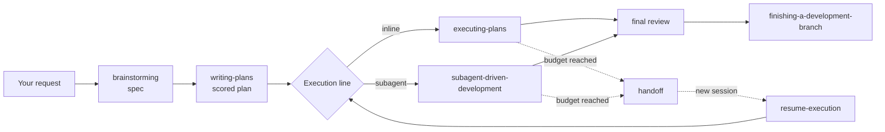

# Darkraise plugins

Plugins for Claude Code and Codex, distributed through the `darkraise`
marketplace. One of them does most of the work:

- **[dr-forge](plugins/dr-forge/README.md)** turns a request into a reviewed
  spec, a scored plan and a tiered execution run. A strong model plans, cheaper
  implementers execute each task literally, and one strong judge seat makes
  every judgment call. On Claude Code it also carries the cockpit, a mod that
  shows a long session at a glance: context against its handoff budget, usage
  limits with forecasts, running shells and subagents, the dr-forge run, and the
  repo. It sends Discord notifications when a turn needs you, and keeps AI
  attribution out of your commits.

The cockpit's **Run** card follows a dr-forge run task by task, and its
**Hand off** button ends a session cleanly at the budget dr-forge sets.

<p align="center">
  <picture>
    <source media="(prefers-color-scheme: dark)" srcset="docs/images/cockpit-flight-deck-dark.png">
    
  </picture>
</p>

## Contents

- [Plugins](#plugins)
- [Install](#install)
- [Using dr-forge](#using-dr-forge)
- [Migration](#migration)
- [Development and validation](#development-and-validation)

## Plugins

| Plugin | What it is | Claude Code | Codex |
| --- | --- | --- | --- |
| [dr-forge](plugins/dr-forge/README.md) | Brainstorm, plan and execute with scored tasks, tiered implementers and criteria-based review; on Claude Code also the session cockpit pane, Discord notifications and attribution guard | Yes | Yes (the cockpit is Claude Code only) |
| [dr-status](plugins/dr-status/README.md) | A status line with git detail and usage meters, framed in the account's color | Yes | No |
| [dcc-darkraise-ui](plugins/dcc-darkraise-ui/README.md) | Teaches agents to write idiomatic darkraise-ui code | Yes | Yes |
| [dcc-darkraise-win32ui](plugins/dcc-darkraise-win32ui/README.md) | Teaches agents to write idiomatic Darkraise.Win32UI code | Yes | Yes |

## Install

### Claude Code

```text
/plugin marketplace add darkraise/darkraise-ai-plugins
/plugin install dr-forge@darkraise
```

The other plugins install the same way (`dr-status@darkraise`,
`dcc-darkraise-ui@darkraise`, `dcc-darkraise-win32ui@darkraise`). Start a new
session, or run `/reload-plugins`, after installing.

Disable the upstream `superpowers`, `dcc-superpower-companions` and
`andrej-karpathy-skills` plugins before you enable `dr-forge`.
Same-named skills in two enabled plugins can trigger twice.

An installed copy stays at the version it was installed at. To take a new
release, run `claude plugin update <plugin>@darkraise` and start a new session.

### Codex

```text
codex plugin marketplace add https://github.com/darkraise/darkraise-ai-plugins.git
codex plugin list --marketplace darkraise --available
codex plugin add dr-forge@darkraise
```

Codex reads `.agents/plugins/marketplace.json`, which lists `dr-forge` and the
two UI plugins; `dr-status` is Claude Code only. Register
the repository root (its Git URL or a local checkout's absolute path), not the
catalog file: Codex 0.153.4's CLI rejects direct catalog-file registration, and
root discovery selects the dedicated Codex catalog. On Codex, dr-forge uses the
client's native agent tools; see
[native-codex.md](plugins/dr-forge/reference/native-codex.md).

### Requirements

dr-forge needs Bash, Git and `jq` (on Windows, Git for Windows provides Bash).
The cockpit is built against Claude Code 2.1.295 to 2.1.296; the mod API is
early access and may change between releases.

## Using dr-forge

dr-forge is a standalone fork of
[superpowers](https://github.com/obra/superpowers) 6.3.0. Its skills fire on
their own: a `SessionStart` hook loads the routing rules, so you describe what
you want and the right skill takes over. You can also name a skill, for example
"use dr-forge:brainstorming".



### A feature, start to finish

1. **Describe the change.** "Add CSV export to the reports page." The
   `brainstorming` skill asks clarifying questions one at a time, proposes
   approaches (an open decision may go to `selecting-approaches`, which can
   rank three candidates with a judge), and writes a spec under
   `docs/forge/specs/`. It also asks whether the plan should run
   sequentially or in parallel waves.
2. **Approve the spec.** `writing-plans` turns it into a plan under
   `docs/forge/plans/`. Every task is scored on four axes (files, spec
   completeness, coupling, risk), and the score picks its implementer, such as
   `impl-sonnet-low` or `impl-opus-high`. `plan-lint` checks the plan and a
   judge reviews it before it is saved. Saving a plan is a hard stop, so the
   session hands off there.
3. **Start a fresh session to execute.** Say "resume" or "continue the plan".
   `resume-execution` checks the worktree against the ledger and hands over
   to the mode the plan's `**Execution:**` line names:
   - **Inline** (`executing-plans`): the session implements the tasks itself,
     delegating only heavy ones.
   - **Subagent** (`subagent-driven-development`): each task goes to its
     implementer agent and is reviewed against scored criteria, with up to five
     fix rounds that climb an escalation ladder.
4. **Answer one question before the first task.** What finishing should do if
   its menu goes unanswered for 30 minutes: merge locally, push and open a pull
   request, keep the branch, or wait.
5. **Let it run.** Progress goes to a ledger at
   `.forge/sdd/<plan>/progress.md`. Judgment calls go to `judge-opus`,
   and plan corrections are appended through `scripts/plan-amend`, so the plan
   on disk never changes.
6. **Finish.** After the last task, a whole-branch review runs (with a Codex
   round when the official Codex plugin is usable), then
   `finishing-a-development-branch` shows its menu.

### Long sessions and handoff

Every request re-reads the whole context, so a session past its budget costs
more on every turn. dr-forge prints a budget line before every task and
review (`budget: 312k of 465k (67%) — ok`). When it says `handoff`, the
`handoff` skill finishes the task in flight, writes
`.forge/handoff/latest.md`, and ends with a resume guide. Open a new
session and say "resume". The budget follows your `autoCompactWindow`: 465k at
650,000, and 604k on a 1M model with the window at 800,000. See
[session-budget.md](plugins/dr-forge/reference/session-budget.md).

### Other skills worth knowing

| Ask for | Skill |
| --- | --- |
| "What should I do next?" or "Where does this stand?" | `project-status` (reads only) |
| A new product with several subsystems | `planning-a-product` (writes a milestone roadmap) |
| A bug or failing test | `systematic-debugging` |
| Running the project's declared checks | `running-gates` |
| A slow test suite | `test-simplifier` |
| Updating an older plan to the current format | `revising-plans` |

### Overriding the plan

Edit a task's `**Implementer:**` line to choose another agent, and add
`**Override:** <reason>` below its Evaluation line so `plan-lint` reports a
warning instead of an error. The `**Execution:**` line is binding: change it to
switch between inline and subagent mode.

The [dr-forge README](plugins/dr-forge/README.md) covers the scoring rubric,
the agent roster, the escalation ladder, parallel waves, the Codex executor
lane and cross-family review.

### The cockpit

The cockpit is a hooks module, not a set of skills, so it costs the model no
context. It opens by itself at session start once the terminal is 144 columns
wide, and `/cockpit` opens it at any width. In fullscreen at 110 columns or
more it docks beside the transcript; otherwise it sits above the prompt.

#### The pane

In a terminal each section is a framed card under a **Now** row that says what
the session is doing:

```
● running 2m14s · step 18 · Bash in impl-sonnet-low
╭ Context ─────────────────── 68% of handoff · ≈7 turns ╮
│ ▰▰▰▰▰▰▰▰▰▰▰▰▰▰▰▰▰▰▰▰▱▱▱▱▱▱▱┃▱▱▱▱▱┊▱▱▱▱▱▱▱▱▱▱▱▱▱▱ │
│ 412k of 1.0M ┃ handoff 604k ┊ compacts 744k      │
│ ╭──────────╮ ╭─────────╮ ╭──────────╮             │
│ │ Hand off │ │ Compact │ │ Settings │             │
│ ╰──────────╯ ╰─────────╯ ╰──────────╯             │
╰───────────────────────────────────────────────────╯
╭ Usage ──────────────────────────── $4.85 · $2.35/h ╮
│ 5h  ▰▰▰▰▰┊▱▱▱▱▱▱▱▱▱▱▱▱▱▱▱▱▱▱▱▱▱▱▱▱▱▱▱▱▱▱  23%     │
│     resets in 3h40m · on pace                     │
╰───────────────────────────────────────────────────╯
╭ Run ──────────────────────────────── round 2 · 3/6 ╮
│ ✓ Task 3: Draw the context section · clean        │
│ ▸ Task 4: Draw usage and agents                   │
│   round 2 · impl-sonnet-low                       │
╰───────────────────────────────────────────────────╯
```

In the Claude desktop app (its Code tab) the pane is a flight deck, shown at the
top of this page: the account first, then the activity line, then gauges for
the context and the 5-hour and 7-day limits, then a panel per section. It
follows your system's light or dark theme.

| Section | What it shows |
| --- | --- |
| **Account** | Email, organization, billing, model and effort, Remote Control, and the config directory. Each account gets its own frame color. |
| **Context** | Context used against the handoff budget and the auto-compact point, the turns left at the recent pace, and the largest `/context` categories. |
| **Usage** | The 5-hour and 7-day limits with resets, whether each lasts to its reset at the current pace, and the session's cost per hour. |
| **Shells** | Background shells still running, timed to the second. |
| **Agents** | Subagents running and recently finished, with input, cache share and output per agent type. |
| **Plan / Run** | The todo list, or in a dr-forge run its ledger: review round, tasks done, blocked tasks, and the unattended finish countdown. |
| **Repo** | Repository, folder, branch, ahead and behind counts, and changes. |
| **Guard** | Commits and pull requests the attribution guard refused. |

#### Minimize to a band

**Minimize** (`m`) closes the pane and draws the cockpit as a two-line band
above the prompt, and **Expand** opens the pane again. The choice is saved, so
the next session opens the same way. The band
keeps the three readings with their pace, plus the agents, shells and branch.

<p align="center">
  <picture>
    <source media="(prefers-color-scheme: dark)" srcset="docs/images/cockpit-band-dark.png">
    
  </picture>
</p>

```
╭─ you@example.com · subscription · Remote ● connected ───────────────────────────────── Expand ─╮
│ ctx ▰▰▰▰▱▱▱┃▱▱ 61% · ≈9 turns  ·  5h ▰▰▱▱┊▱▱▱ 23% on pace · 3h40m  ·  7d ▰▰▰┊▰▱▱▱ 61% out in 2d4h │
│ ● 1 agent  ·  $ 2 shells · longest 12m  ·  ~/code/shop/web ⎇ feat/pane* ↑2 ↓1 ~1 ?1              │
╰─────────────────────────────────────────────────────────────────────────────────────────────────╯
```

#### Buttons and commands

| Key | Button | Does |
| --- | --- | --- |
| `h` | **Hand off** | In a dr-forge session, asks Claude to finish the task in flight and hand off. Turns accent past `warnAt`. |
| `r` | **Resume** | Outside a dr-forge session, queues the prompt that resumes a handoff under three days old. |
| `c` | **Compact** | Runs a compaction. |
| `s` | **Settings** | Opens the settings view; `b` goes back. |
| `m` | **Minimize** | Closes the pane for the band above the prompt. |

The hotkeys work while the pane has the keyboard. From the prompt:

```text
/cockpit                          open the pane
/cockpit settings                 open the settings view
/cockpit notify url <webhook>     set the Discord webhook
/cockpit notify mention <id>      ping your Discord user for events that need you
/cockpit notify test              send a sample message
```

#### Discord notifications

The cockpit can post to a Discord channel when a turn needs you, which works
the same over ssh and tmux. Create a webhook in Discord (channel settings, then
Integrations, then Webhooks, then copy the URL) and paste it in the settings
view's **Notifications** group or with `/cockpit notify url`. By default it
sends approvals and questions that wait, long turns ending, failures, blocked
dr-forge tasks, the handoff budget and usage limits. Excerpts pass
through a redactor, and `notifyDetail` `brief` leaves them out.

#### Settings

Change settings in the pane's settings view, with
`bash <plugin-root>/scripts/forge-config set <key> <value>`, or in
`~/.dr-forge/config.json`:

```json
{ "layout": "compact", "sections": "context,usage,plan", "warnAt": 70 }
```

The most useful are `layout` (`auto`, `full` or `compact`), `sections` (which
sections show, in order), `warnAt` (where **Hand off** lights up),
`handoffTokens` (a fixed budget instead of dr-forge's rule) and
`notifyOn` (which Discord events send). The
[dr-forge README](plugins/dr-forge/README.md#settings) lists every option.

## Migration

Refresh an existing root marketplace registration before installing renamed
plugins. A source pinned to an old commit must explicitly move to the revised
release. If adding the renamed URL conflicts with the existing `darkraise`
registration, record installed plugin IDs and scopes, remove the old registration,
add the new root, and reinstall the selected supported plugins. Preserve plugin
data when uninstalling; do not assume marketplace removal keeps installations.

Disable the old Claude `dcc-statusline` and `dcc-superpower-companions` plugins
before enabling `dr-status` and `dr-forge`, so their hooks do not run twice.
Statusline script storage remains `~/.claude/dcc-statusline/`; a registry at
`~/.claude/dcc-statusline-installations.json` remembers custom account destinations.
Set `DCC_STATUSLINE_HOME` only when installing or intentionally moving a copy.
Sync, status, doctor, and uninstall use the recorded destination afterward.
For statusline registration, run `/dr-status install`, or `/dr-status install
--all` for all discovered accounts.

Telegram notification support is retired. Uninstall `dcc-telegram-notify` from
existing clients yourself; removing its catalog entry does not remove cached
installations. Likewise uninstall an old statusline installation from Codex.
Repository changes do not delete Telegram configuration, erase tokens, or revoke
the bot token. Those remain separate user-controlled actions.

## Development and validation

Public plugin names must match their directories and catalog entries. Add a
native Codex manifest only for a plugin supported by Codex. Shared client
manifests must have equal release versions. `dr-forge` explicitly sets
empty Codex hooks to prevent discovery of its Claude hook file.

```text
node scripts/validate-repository.mjs
node scripts/test-all.mjs
claude plugin validate .
claude plugin validate plugins/<plugin>
claude plugin test plugins/dr-forge
```

Run them with bounded commands. Installation and upgrade tests use disposable
profiles, caches, and Git repositories; they must never modify your installed
plugins or invoke paid models.

`node scripts/test-all.mjs` runs the full maintained suite. Windows CI splits
the same suites across six jobs using `--shard 1/6` through `--shard 6/6`.
Add `--list` to inspect a shard without running it. Shards use approximate
Windows timings in `scripts/test-shards.mjs` to balance the workload; new suites
are discovered automatically. Each run prints suite durations so the scheduling
weights can be refreshed when runtimes change.

[MIT](LICENSE) © 2026 Darkraise
