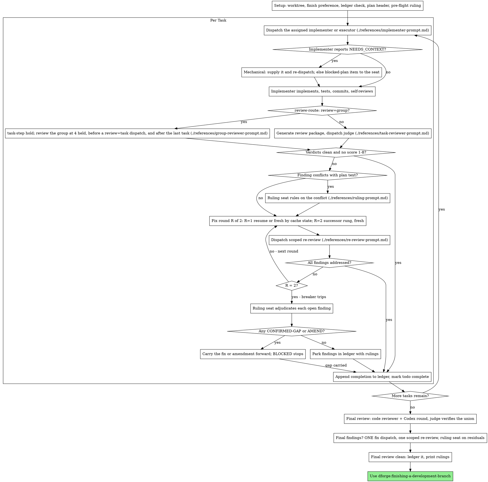

# Subagent-Driven Development

## After compaction

If this session was compacted — a compaction snapshot or summary sits above —
your memory of the run is gone, and only the start of this file may have come
back. Before anything else:

0. In an auto run, when `scripts/auto-run status` says setup is due, or when
   no ledger names this plan, no task has started: skip the rest of this
   section and follow Setup from its first step.
1. Run `scripts/sdd-workspace PLAN_FILE` (see using-dforge §Session Budget),
   and read `progress.md` and `handoff.md` in `<ledger dir>`, not in the
   directory it prints: while progress lives in darkmem the two differ.
2. Trust the ledger and `git log` over the summary. For each task the last
   ledger line decides: `complete` is done;
   `fix round 1/2` resumes at round 2 with a fresh dispatch, and `fix round 2/2`
   goes to the breaker (an older run's `R/5` maps as §The Ledger's Recovery
   says); an assigned line with commits after its base
   goes to review;
   `awaiting group review` is reviewed by the next group dispatch, never re-dispatched.
   An assigned line ending `thread pending` is an executor
   wrapper that may still be running: find it in the snapshot's background
   list and wait for its notification, or stop it and record a Ruling.
   A `Wave <k>: started` line with no later `integrated` or `serialized` line
   is a parallel wave in flight: follow
   [parallel-waves.md](../../reference/parallel-waves.md) §Recovery.
3. When every task has its `complete` line, run `scripts/context-size --final`
   and go on to Final Review or finishing whatever it prints: the final phase
   never hands off. In an auto run it also moves the run to the final phase,
   and a `compact` line still ends the turn on `Auto run: compacting`.
   Otherwise run `scripts/context-size`; on exit 5, finish the task in flight,
   then invoke dforge:handoff. In an auto run, exit 6 (`compact`) is
   [auto-run.md](../../reference/auto-run.md) §The budget line.
4. Re-read this skill in full before the next dispatch, and
   [delegated-task.md](../../reference/delegated-task.md) when a task is
   mid-loop (an agent-named assigned line or `fix round R/2`).

## Auto run

When `scripts/auto-run status` exits 0, this run is unattended
([auto-run.md](../../reference/auto-run.md)); read that file once per session.
What changes here:

- **After any compaction**, whether or not a prompt asks for it (the
  cockpit's prompt does; a compaction Claude Code starts on its own comes with
  none), run `scripts/auto-run after-compact` before step 0 above. On
  `handoff` (exit 5), invoke dforge:handoff,
  then run `scripts/auto-run clear` and end as auto-run.md §Clears says.
- **Setup:** skip the finish-preference question; run `scripts/auto-run phase execute`
  from the execution worktree, once dforge:using-git-worktrees has created it.
  Exit 4 means the worktree step was skipped: create the worktree, then run
  the command again from it.
- **Nothing stops for your human partner.** A ruling-seat or exhausted
  `BLOCKED` goes on the pending list and one Fable batch runs at once. An
  irreversible, security-sensitive or outside-the-worktree action is never
  performed (the finish action is the one exception).
  A task Fable gives no ruling for, or whose action is never performed, is
  deferred, and every task that depends on it (its `**Depends on:**` line
  names the task; in a plan without those lines, its `Consumes:` line cites
  a Contracts entry the deferred task's `Produces:` line cites): write
  `Task <N>: complete (deferred by the auto run) — done: nothing; verified: not run; remaining: <the item>[; partial commits <a7>..<b7>, kept for the final review | ; unmerged task ref <ref>]; discovered: none; assumptions: none; Ruling: <why> — <cost if wrong>`
  and a deferred register row for each. In a wave, a deferred task's branch is
  not merged, so its commits lie outside the final review's range: its line
  takes `unmerged task ref <ref>`, the ref `scripts/wave ref PLAN_FILE <N>`
  prints, in place of the partial-commits clause, and its register row's note
  names the same ref. Other tasks keep running.
- **Each task:** right after its `Task N: complete` line, run
  `scripts/auto-run task-complete`. After each wave, or each task in
  sequential mode, run the Fable batch when `scripts/auto-run decision list`
  prints anything. When that line leaves every task with its `complete` line
  (in subagent mode, after the last wave's merge), run
  `scripts/auto-run phase final` next, before any budget check and before the
  turn ends, so a compaction from there on never hands off.
  A `task-complete` exit 5 means the run stopped (a task was completed in the
  primary checkout): end as auto-run.md §Stopping says.
- **The budget line** reads `budget (auto…)`. On `compact` (exit 6), finish
  the task in flight (a wave through its merge), then end the turn with
  `Auto run: compacting` as its last line. On `handoff`, finish the task in
  flight, then invoke dforge:handoff, then run `scripts/auto-run clear` and end as auto-run.md §Clears says.
  The tail rule and the final-phase limit do not apply;
  `scripts/context-size --final` prints the auto line too.
- **Final review:** run `scripts/auto-run phase final` and, when the pending
  list is not empty, the Fable batch first; the review's findings take the
  same ladder.
- **A turn ends** only on `Auto run: compacting` or `Auto run: clearing` as
  its last line, or after `scripts/auto-run stop --reason "<why>"` when the
  run must stop.

## Select the host first

Identify the host through its native tool schemas, never by which executables
are installed. On Codex, follow [native-codex.md](../../reference/native-codex.md):
its `codex-v4` protocol replaces every Claude agent and external-CLI
invocation below, including the final branch review, and carries its own
conversion, retry and reserve rules. On Claude, use the seats and loop below.

## Overview

Execute a plan by dispatching, per task, the implementer its
`**Implementer:**` line names; a judge-scored review of each task, alone or, for a low-risk task, in a group with others; and
a broad whole-branch review at the end.

**Why subagents:** You delegate tasks to specialized agents with isolated context. By precisely crafting their instructions and context, you ensure they stay focused and succeed at their task. They should never inherit your session's context or history — you construct exactly what they need. This also preserves your own context for coordination work.

**Why tiered agents:** the plan records, per task, a model-and-effort pairing
chosen by the rubric in [ladder.md](../../reference/ladder.md). Each fleet agent
pins both in its frontmatter, so the tier the plan recorded is the tier that
runs without the dispatch naming either. The Agent tool has taken an `effort`
argument since Claude Code 2.1.292, but a fleet dispatch passes neither it nor
`model`: either one overrides the pinned value.

**Core principle:** Assigned subagent per task + scored task review + broad final review = high quality, fast iteration

**Narration:** between tool calls, narrate at most one short line — the
ledger and the tool results carry the record.

**Continuous execution:** Do not pause to check in with your human partner between tasks. Execute all tasks from the plan without stopping. The only reasons to stop are the four named below, or all tasks complete. "Should I continue?" prompts and progress summaries waste their time — they asked you to execute the plan, so execute it.

**Rulings, not stalls.** A running plan does not wait on a human, and it does
not wait on your judgment either. You decide the mechanical problems yourself —
the dispatch-problems table, resuming or re-dispatching by cache state, batching, a report missing a required section, a tool failure — and
record each in the ledger as `Ruling: <what you decided> — <why> — <what it
costs if wrong>`, said aloud. Everything that needs judgment about the plan,
the spec or a finding goes to the ruling seat (see The Ruling Seat): it reads
the whole plan and the spec, which you never read, and returns a verdict you
carry out. A wrong ruling costs rework your human partner can see and undo; a
session parked on a question costs their whole day and buys nothing.

Four things stop you, and only these: an irreversible or destructive
operation; a security-sensitive action; a side effect outside this worktree
that norms say you ask about first (a merge, a push to a shared branch, a
publish); and a ruling-seat `BLOCKED` verdict — a plan so broken that every
path forward is a guess. For those, stop and ask — except in an auto run,
which asks nothing (see Auto run).

**Every session ends with the next step.** Whenever this session ends before
the plan is finished — one of those four stops, a context-budget handoff, or
your human partner asking you to stop — first reconcile live children
exactly as dforge:handoff step 0 says: wait for them, or `TaskStop`
them and record a Ruling. Tell your partner which you did. Then run
`scripts/next-step PLAN_FILE` (see using-dforge §Session Budget) as your
last action. The last thing in your final message is the block it prints,
verbatim. It also rewrites the `## Next session` section of
`<latest.md>`; if it exits 4, say the handoff
file could not be written. When the plan finishes,
dforge:finishing-a-development-branch runs it instead.

## When to Use

When a plan's `**Execution:**` line names `subagent`. Without a plan, use
dforge:brainstorming first; with a line that names `inline`, use
dforge:executing-plans. What this mode adds over inline is a fresh
implementer per task and a judge-scored review after each one.

The plan's `**Execution:**` line decides the mode. Your human partner's explicit
instruction switches it in either direction, and only at a task boundary where
every earlier task is complete, recorded as a `Ruling:` line. Inline mode also
escalates here on its own when a task will not converge; it arrives with a
`Task <N>: escalated inline -> subagent` ledger line, and the Recovery table
below says what to do with it.

## The Process



## Setup

Ensure the work happens in an isolated workspace: use
dforge:using-git-worktrees to create one or verify the existing one.
Never start implementation on a main/master branch without your human
partner's explicit consent.

**Ask the finish preference first.** Before this run writes anything to its
ledger, follow [finish-preference.md](../../reference/finish-preference.md):
ask what finishing should do once the final review is clean, record the
answer, and start work in the same turn. Skip it when
`scripts/finish-choice get --plan PLAN_FILE` already prints a choice (it does
so unasked when the `finishAction` setting names an action), or when this
plan's ledger already exists: a resumed run does not stop to ask. When
the spec's `## Decisions` holds a `Finish: <action>` line, run
`scripts/finish-choice set <action> --plan PLAN_FILE` instead of asking. It is
the run's one question; nothing else waits on your human partner.

Conversation memory does not survive compaction. In real sessions,
controllers that lost their place have re-dispatched entire completed task
sequences — the single most expensive failure observed. Track progress in
a ledger file, not only in todos.

- Each plan owns a workspace: at skill start, run
  `scripts/sdd-workspace PLAN_FILE` (see using-dforge §Session Budget) — it prints the plan's git-ignored
  directory (`<repo-root>/<state>/sdd/<plan-basename>/`), home to
  every artifact for THIS plan: briefs, reports, review packages. Its ledger
  and handoff note live in `<ledger dir>`.
  Another plan's directory is never yours to read or write.
- Check for this plan's ledger at `<ledger dir>/progress.md`. If its first
  line names your plan file, recover each task's state with the Recovery
  table under The Ledger. A ledger whose first line names a different plan
  file — or a stray ledger at the old flat path `<state>/sdd/progress.md`
  — is another plan's progress: leave it in place and start your own, fresh.
- Create the ledger with its identity as the first line:
  `# SDD ledger — plan: <plan name>` — `bash <plugin-root>/scripts/dforge-path name PLAN_FILE`,
  so the ledger names the plan in either store.
- When a register covers this plan's spec, mark the rows this plan carries as
  in flight once, at the start of the run, skipping any row already at `verify`
  or `done`: `scripts/register set <register> <id> doing`. The register is read by
  `next-step`, `repo-audit` and dforge:project-status, so a run that
  never says it started reads as unscheduled work everywhere else.
- Create `<ledger dir>/handoff.md` from the template in dforge:handoff
  if it does not exist. Update it in the same message as a ledger write
  whenever an owner constraint, gotcha, prohibition or open question changes —
  not after every task.
- Read `<docs>/distilled/constraints.md` when the project has one. Its
  entries bind like the owner constraints in `handoff.md` and yield to them
  wherever both speak; an absent file is not an error. See
  [project-state.md](../../reference/project-state.md).
- The ledger is your recovery map: the commits it names exist in git even
  when your context no longer remembers creating them. After compaction,
  trust the ledger and `git log` over your own recollection.
- `git clean -fdx` will destroy the workspace (it's git-ignored scratch); if
  that happens, recover from `git log`.

Read the plan's header, never the whole plan: run
`scripts/task-brief --header PLAN_FILE` (see using-dforge §Session Budget), and read the
file it prints (`<workspace>/plan-header.md`). Note the Execution line, the
`**Parallelism:**` line when there is one, the Global Constraints and the
Contracts, and create a todo per Task index entry.
A plan written before 1.4.0 may have no Task index: then run
`scripts/task-brief PLAN_FILE N` for N = 1, 2, … until it exits 3, and take
each task's title from its brief's first line. You never read the spec: the
ruling seat, the plan review and the final review do. If the plan's
`**Spec:**` path is unreachable, note it in the ledger and say so in every
ruling-seat dispatch; the seat marks its rulings provisional.

Before dispatching Task 1, send one `preflight` item to the ruling seat (see
The Ruling Seat). It scans the whole plan against the spec for:

- tasks that contradict each other, the Contracts, or the Global Constraints
- anything the plan explicitly mandates that the review rubric treats as a
  defect (a test that asserts nothing, verbatim duplication of a logic block)

- for a plan whose `**Parallelism:**` line names waves, every pair of tasks
  in one wave that could observe each other's change

The seat returns a table, not a verdict: one row for every pair of tasks that
share a file or an interface, and one row for every task on whether its own
text agrees with itself. Verdict blocks follow for the rows that found
something. Write the whole output to `<workspace>/preflight.md`, carry out
each verdict, log `Ruling: pre-flight — <clean | K findings, see
preflight.md> — none`, and dispatch Task 1. A resumed ledger that already
holds that line skips the dispatch. The review loop remains the net for
conflicts that only emerge from implementation.

## Seats

Every seat is named, so nothing silently inherits your session's model.

| Seat | Agent | Model argument |
|---|---|---|
| Ruling seat | The seat `scripts/review-route PLAN_FILE --ruling <kind> [<task> ...]` prints (The Ruling Seat) | None |
| Final review | The seat `scripts/review-route PLAN_FILE --final` prints ([final-review.md](../../reference/final-review.md) step 1) | None |
| Final fix wave | The implementer `scripts/review-route PLAN_FILE --final-fix <file> ...` prints ([final-review.md](../../reference/final-review.md) §Fixing what it finds) | None |

The implementer, external implementer, task reviewer and scoped re-review seats,
and the rule that fleet agents take no `model` or `effort` argument, are in
[delegated-task.md](../../reference/delegated-task.md) §Seats.

**General-purpose seats always take an explicit model.** An omitted model
inherits your session's model — often the most capable and most expensive —
which silently defeats the choice.

## The Ledger

This skill owns every line in `<ledger dir>/progress.md`. The grammar:

```
# SDD ledger — plan: <path>
Task <N>: implementer <agent> (assigned; base <sha7>[; part A][; reserve tier][; scored at dispatch][; wave <k>][; executor <id> <model>/<effort>, thread <id>][; escalated from <old>: BLOCKED][; <substitution>])
Task <N>: fix round R/2 (X addressed, Y open — <one-liners>; commits a..b[; re-review skipped (<n> lines)]; resumed | fresh (<why>) | escalated <old> -> <new> | HANDBACK to <agent>)
Group <a>-<b>: review round R/2 (<same fields as a fix round>)
Task <N>: awaiting group review (commits <a7>..<b7>)
Group <list>: review round R/2 (Task <N>: <k> open — <one-liners> | clean; …; commits <a7>..<b7> (Task <N>)[, <a7>..<b7> (Task <M>)])
Wave <k>: started (base <sha7>; Tasks <a>-<b>; at most <c> at once)
Wave <k>: serialized — <reason>
Wave <k>: check failed — <command> → <one-line summary>
Wave <k>: fix round R/2 (<same fields as a fix round>)
Wave <k>: integrated (head <sha7>; <command> → pass)
Task <N>: escalated inline -> subagent — <trigger>          (written by inline mode only)
Task <N>: minor (deferred): <one-liner>
Task <N>: parked — <finding> — Ruling: <why the code stands>
Task <N>: Ruling: <finding> — <what was decided and why>
Task <N>: BLOCKED — <agent> exhausted — <what a human must decide>
Task <N>: BLOCKED — ruling seat — <what a human must decide>
Task <N>: Ruling: amendment A<k> — <reason> — <cost if wrong>
Ruling: amendment A<k> (Header) — <reason> — <cost if wrong>
Task <N>: complete (commits a..b[; merged <sha7>], review clean | K parked[, C carried to Task M | C carried to final review][; parts A, B][; scores spec s / scope c / verification v / quality q, seat <seat>]) — done: …; verified: <command → result>; remaining: none | <parked>; discovered: none | …; assumptions: none | …
Ruling: <what> — <why> — <cost if wrong>
Acceptance QA: dispatched (base <sha7>)
Acceptance QA: complete — <p> pass, <f> fail, <k> flaky, <c> cannot-test, <d> demo
Final fix: implementer <agent> (assigned; base <sha7>)
Final review: clean (commits <merge-base7>..<head7>[, K parked])
```

- `Acceptance QA:` lines are written by
  [final-review.md](../../reference/final-review.md) step 0.5. On recovery:
  a `complete` line skips step 0.5; a `dispatched` line with no `complete`
  line and `<workspace>/acceptance-report.md` present means read the report
  and write `complete`; with no report, re-dispatch QA once with `[MODE]`
  `rerun`. Step 0.5 holds the rest of the procedure.
- After each `complete` and `fix round` line, run `scripts/darkmem-sync push`;
  at `complete`, also promote the task's durable facts
  ([project-state.md](../../reference/project-state.md) §darkmem sync points).
- Every task gets its own assigned line and its own complete line, including
  tasks reviewed as a batch or in a group review. Batches are contiguous task
  ranges named `Group <a>-<b>`; only a batch's review rounds log on its Group
  line. A group review's `<list>` is
  the task numbers in ascending order joined by commas (`Group 4,6,7`), or a contiguous range (`Group <a>-<b>`).
  Its clause attributes every finding to its member, and its commits clause
  holds one `<a7>..<b7> (Task <N>)` range per member fixed in the round, in
  sequential and wave mode alike.
- `Wave` lines and the `wave` and `merged` fields belong to parallel waves
  ([parallel-waves.md](../../reference/parallel-waves.md)); a sequential plan
  never writes them.
- The scores clause is present whenever a review seat, Codex or judge, scored the task.
- The checkpoint after the `—` comes from the report's
  `## Discovered issues (not fixed)` and `## Assumptions made` sections — the
  implementer's or the Codex wrapper's. `done` is a one-line summary of the
  task's deliverable, `verified` the covering command and its result, and
  `remaining` the parked findings. A batch report's sections are copied onto
  each task's complete line, attributed per task where the report names one.
- Write each line in the same message as your other bookkeeping, never later.
- A ruling-seat `BLOCKED` that belongs to no task (a `preflight` row, a
  Header amendment) is logged against the lowest-numbered task without a
  complete line, so recovery reads it as that task's terminal line.

**Recovery.** For task N, take the last line in file order among its
`Task <N>:` lines and any `Group` line covering N
(a range covers the tasks inside it; a comma list covers the tasks it names),
stepping over `minor (deferred)`, `parked`, `Task <N>: Ruling:`, and bare
`Ruling:` lines. A group review's `Group` line is the one whose clause starts
`Task <N>:`. Then:

| Last line | Action |
|---|---|
| `complete` | Done; never re-dispatch |
| `BLOCKED` | Terminal; never re-dispatch. It is a stop of the fourth class for any task that depends on it; name it in your final message |
| `awaiting group review` | Reviewed by the next group dispatch ([delegated-task.md](../../reference/delegated-task.md) §3a); never re-dispatch its implementer |
| `review round 1/2` on a group review's `Group` line | Run round 2 for each member whose clause is open, one member at a time, a fresh dispatch after compaction |
| `review round 2/2` on a group review's `Group` line | Send each member's open findings to the breaker |
| `review round 1/2` on a `Group` line, or `review round 1/5` from an older run | Resume the group's loop at round 2 — a fresh dispatch on the successor rung |
| `review round 2/2` on a `Group` line, or `review round R/5` with R >= 2 from an older run | Go to the breaker |
| `escalated inline -> subagent` | Inline mode escalated this task here. Dispatch the first rung on the escalation table ranked strictly above both the task's `**Implementer:**` agent and the inline session's rung, the successor of whichever ranks higher ([escalation.md](references/escalation.md) §Escalating out of inline mode) fresh at round 1 of 2, with the brief and the task's preceding fix-round lines; the inline session already spent three rounds at or above the assigned tier, and the task's earlier commits are in `git log` |
| `implementer <agent> (assigned …; wave <k>)`, or a `fix round R/2` after one | A parallel task: apply [parallel-waves.md](../../reference/parallel-waves.md) §Recovery |
| `implementer <agent> (assigned …)` or `fix round R/2` | Apply [delegated-task.md](../../reference/delegated-task.md) §Recovery |
| none | Not started |

A `Task`, `Group` or `Wave` round line written before the two-round cap reads `R/5`: R = 1 resumes at round 2, and R >= 2 goes to the breaker.
A `Wave` fix-round line resumes the wave's fix loop
([parallel-waves.md](../../reference/parallel-waves.md) §5) by the same rule.

A ledger written by an older version of this skill may carry an assigned line
without `base`: take the previous task's complete-line head, or the branch's
merge base for Task 1. An old `(scored at dispatch)` line reads as assigned.

**Plan state.** Every task complete and no `Final review:` line: go to Final
Review; an `Acceptance QA: dispatched` line with no `complete` line resumes at
its step 0.5. A `Final fix:` line and no `Final review:` line: the fix wave was
dispatched; after compaction the agent id is gone, so re-dispatch that agent
fresh, then continue Final Review at the scoped re-review. A
`Final review: clean` line: the review is done — go to
dforge:finishing-a-development-branch.

## The Ruling Seat

Judgment belongs to the ruling seat, never to you, whatever model you run on.
It reads the whole plan, the spec, `amendments.md` and the ledger; you read
the header and one brief at a time.

**When.** Send the seat an item at each of these points, batching every item
that arises at one point into one dispatch:

| Kind | Decision point |
|---|---|
| `preflight` | Once, before Task 1 (Setup) |
| `plan-conflict` | A review finding labelled plan-mandated, or one that conflicts with what the plan's text requires |
| `cannot-verify` | Every "⚠️ Cannot verify from diff" item, before the task completes |
| `breaker` | Every finding still open after round 2/2 |
| `blocked-plan` | An implementer BLOCKED because the plan is wrong |
| `executor-empty-diff` | An external executor's fix round that returned DONE with an empty diff and an argument ([executor-lane.md](../../reference/executor-lane.md)) |
| `final-residual` | Findings still open after the final review's one fix wave |

**How.** Write `<workspace>/rulings-<point>-<task>.md` — `<task>` is the task
number the items concern, or `plan` for a plan-level point, so a recurring
point never overwrites an earlier file — listing each item: an id, its
kind, its task (or `plan`), and the paths it needs — brief, report, review
packages — with the findings copied verbatim. Run
`scripts/review-route PLAN_FILE --ruling <kind> [<task> ...]` for the point's
kinds and the tasks its items concern, and dispatch the `primary` it prints
with [ruling-prompt.md](references/ruling-prompt.md), expanding its
placeholders. Items of different kinds at one point share one dispatch, and
`<kind>` is then one comma-separated list, such as
`cannot-verify,executor-empty-diff`. The route prints
`dforge:judge-sonnet-high` (`reason=simple-kind`) when every kind in the list
is `cannot-verify` or `executor-empty-diff` and no task it names is risk 3,
and `dforge:judge-opus` otherwise; `preflight`, `plan-conflict`, `breaker`,
`blocked-plan`, `final-residual` and `acceptance-ambiguous` always go to
`dforge:judge-opus`. On any exit 2, dispatch `dforge:judge-opus` and say why,
quoting its message. Codex hosts, where `review-route` exits 2, use a native
judge at Astra high or above ([native-codex.md](../../reference/native-codex.md)).

**Settled by a mechanical check.** `scripts/task-step review` prints
`check identity:` and `check attribution:` lines for the task's commits. A
reviewer's cannot-verify item that one of those lines answers `clean` (commit
author and committer, or an attribution trailer) goes to no seat; log it as
`Task <N>: Ruling: cannot-verify — settled by task-step check <name> — none`,
with `<name>` `identity` or `attribution`. A check that found something is a
finding for the fix loop, not a cannot-verify item.

**Carry out each verdict**, and copy its `Ruling:` line into the ledger
verbatim:

- **CONFIRMED-GAP** — the finding is real. Mid-task it enters the fix loop
  with the ruling's smallest fix in the fix message. At the breaker it is
  logged `Task <N>: Ruling: <finding> — <ruling>` and carried into the next
  dependent task's dispatch; with no later task depending on it, into the
  next task in plan order; after the last task, into the final review.
- **PARK** — log `Task <N>: parked — <finding> — Ruling: <why>`; the code
  stands.
- **AMEND** — copy the entry, from its `## A?` line through the New fence's
  closing line, to `<workspace>/amend-<id>.md` and run
  `scripts/plan-amend PLAN_FILE <workspace>/amend-<id>.md`. On `amended: A<k> …`, write the amendment ledger line; the next
  dispatch uses a fresh `task-brief`, which carries the amendment. On
  `rejected: …`, make one fresh seat dispatch carrying the entry and the
  rejection output; a second rejection is BLOCKED.

  **A Header amendment is confirmed first.** Before `plan-amend`, write
  `<workspace>/rulings-<point>-<task>-confirm.md`: the original item entry
  unchanged, then the first verdict block verbatim. Confirm it with
  a second, independent `dforge:judge-opus` dispatch, made directly
  rather than through `review-route`, with the same template and
  `[CONFIRM_NOTE]` filled. The second verdict replaces the first and is carried
  out like any verdict; the one fresh dispatch after a `rejected:` is a
  confirming seat too. Log
  `Ruling: header amendment A<k> confirmed by a second judge-opus — <its
  verdict> — if wrong, the plan's Global Constraints or Contracts carry a bad
  rule into every later task`.
- **BLOCKED** — log `Task <N>: BLOCKED — ruling seat — <decision>`, name it
  in your final message, and stop.

Never soften, merge or second-guess a verdict. If you think the seat is
wrong, carry the verdict out anyway: the ledger line is where your human
partner sees it.

## Session Budget

`scripts/task-brief`, `scripts/review-package` and every `scripts/task-step`
digest end their output with the budget line ([session-budget.md](../../reference/session-budget.md)), so you
check the session budget before every task and every review at no extra
request:

    budget: 312k of 465k (67%) — ok — source: record

- `ok` or `unknown`: carry on, however high the percentage. Only the verdict
  stops you.
- `handoff`: finish the task in flight — its reviews, fix rounds and
  `Task N: complete` line — then invoke dforge:handoff. Start no new
  task. The budget holds one task's worst growth, so the task lands before
  compaction.
- The plan's last two tasks are measured against the final-phase limit:
  their brief prints `budget (last 2 tasks)` or `budget (last task)`, and only
  that line's verdict decides. A short tail costs less to finish here than a
  fresh session's baseline and reload.
- After the last task's `Task N: complete` line, run
  `scripts/context-size --final` for the record, then
  continue to Final Review in this session and on to finishing, whatever it
  prints: the final phase never hands off, and a `review-package` budget line
  saying `handoff` does not stop it. If the context fills, Claude Code's own
  compaction is the backstop, and After compaction resumes the final phase
  from the ledger. In an auto run `--final` also moves the run to the final
  phase, and a `compact` line still ends the turn on `Auto run: compacting`.
- On Codex the budget line carries a measured number but no verdict: hand off
  after every 3 completed tasks, or after any task that needed 3 or more fix
  rounds.

## The Task Loop

**Batch small same-shape work.** When the plan lists several contiguous tasks
that are each a small, independent edit of the same kind — the same one-line
fix, constant change, or field addition repeated across files — do not
dispatch one subagent per task. Compose ONE dispatch brief listing every file
and its change, send the whole batch to a single subagent (the highest tier any
of its tasks names), and review its diff as one unit. Reserve
one-dispatch-per-task for work that needs its own judgment, its own tests, or
its own review surface. A batched task never runs on an external executor.
Decide batching from the briefs of the contiguous candidate tasks, extracted
with `task-brief`; you never read task text any other way.

Everything you paste into a dispatch prompt — and everything a subagent
prints back — stays resident in your context for the rest of the session
and is re-read on every later turn. Hand artifacts over as files.

**Waiting on dispatched subagents (Claude Code):** Agent dispatches run in
the background, and so do a Codex review seat and a suite that outruns Bash's
ten-minute foreground cap. While local work remains — ledger updates,
packaging the next review, reading reports — keep working; child results
arrive on their own. When only waiting remains, end the turn: each completion
notification starts the next turn.
Never wait with `Monitor`, `sleep` or a polling loop.

On a turn that a notification started, run `scripts/in-flight` before
anything else and handle every launch that finished, including one whose
notification you missed. Its lines show each launch's start time and idle
minutes. In an auto run, a launch that never notifies is caught by the
cockpit, which after 20 minutes without a turn tells you to stop each launch
idle for 30 minutes or more.

On Codex, `wait_agent` covers the idle window instead, in bounded stretches,
because completion mail does not wake an idle session: see Waiting on
children in `skills/using-dforge/references/codex-tools.md`.

For each task, or batch, run [delegated-task.md](../../reference/delegated-task.md):
dispatch the implementer, handle the report, review the task, the fix loop and
the complete line. Its contract names what the loop needs from you.

**Group reviews.** A task `review-route` grades `review=group` is held after
DONE and reviewed with other held tasks in one judge dispatch, per
[delegated-task.md](../../reference/delegated-task.md) §3a.

**Parallel waves.** When the header says `**Parallelism:** waves — …`, run
every wave of more than one task through
[parallel-waves.md](../../reference/parallel-waves.md): its tasks run at once,
each in its own worktree, each through the same loop above, and are merged and
checked together before the next wave starts. A wave of one task, and every
task of a plan without that line, runs here exactly as above. Batching never
crosses a wave boundary.

## Final Review

This runs in the session that completed the last task. Only a stop the
final phase cannot avoid (your human partner asked, or the session ended)
brings it to a later session, through dforge:resume-execution.

Follow [final-review.md](../../reference/final-review.md), the procedure both
execution skills share. Point the reviewer at the ledger's deferred-minor and
parked lines, the complete lines' `discovered:` fields, and every borderline
(9-13) score, so it can triage which findings must be fixed before merge.

## Finish

When the final whole-branch review is clean and its fixes are committed,
append `Final review: clean (commits <merge-base7>..<head7>[, K parked])` to
the ledger. Do not delete the workspace:
dforge:finishing-a-development-branch removes it with the worktree once
the work is merged or discarded, and until then it is what a later session
resumes from. Then go on to finishing: it is never budget-checked, since it
costs far less than the fresh session a handoff would start.

**Finishing is a Skill tool call in this same turn.** Call the Skill tool
with `dforge:finishing-a-development-branch` right after the ledger
line. Writing its name in a message is not invoking it, and a turn that ends
on a summary of the run leaves your human partner with no integration menu
and no next step. Write no wrap-up message of your own: finishing's message is
the final one.

**Your rulings ride in that message.** Finishing's Step 3 prints every ledger
line containing `Ruling:` — preflight rulings, dispatch rulings, translations,
parked findings, ruling-seat verdicts, all of them — under "Rulings I made",
in the order you made them, each with what it costs if wrong, then every
`BLOCKED` task, then every entry of `<workspace>/amendments.md` in full under
"Amendments made". The lists are exhaustive: they are the only place the
decisions you took on your human partner's behalf reach them, and the only
lasting record of how the plan changed once the workspace is deleted.

## Common Rationalizations

| Excuse | Reality |
|--------|---------|
| "Close enough on spec compliance" | Reviewer found spec gaps = not done. Fix, or hit the cap and send it to the ruling seat — those are the only exits. |
| "I'll fix it myself, dispatching is overhead" | Controller fixes pollute your context and skip review. Resume or re-dispatch the implementer. |
| "One more round will converge" | Past the cap, rounds don't converge — the failure is structural. Send it to the breaker and carry out the seat's verdicts. |
| "The reviewer will just find something new anyway" | Scoped re-reviews verify fixes; they cannot wander. New findings on untouched code go to the ledger, not the loop. |
| "This finding is obviously wrong, I'll drop it" | The ruling seat adjudicates, only at the cap, and every verdict is a ledger entry. Silent discards are forbidden. |
| "I can see the plan is wrong, I'll rule on it myself" | You read the header and one brief; the seat reads the plan and the spec. Send it a plan-conflict item. |
| "The fix was small, skip the re-review" | Unreviewed fixes are how regressions land. Only `task-step rereview --covered` skips one, and only for exactly one open finding, a fix of at most 3 changed lines touching that finding's file, a task below risk 3 and a fix report that names a passing covering test. Every other round ends with a scoped re-review. |
| "Reviews slow the loop down" | The loop without reviews is just unverified churn. Reviews are the loop's brakes and steering. |
| "The budget is at 89%, I'll hand off before the next task" | `ok` means continue. Only a `handoff` verdict stops the loop, and even then the task in flight finishes first. |
| "The final review is clean — I'll summarize the run and stop" | A summary is not a finish. Call the Skill tool for finishing in this turn; its menu and next step are what your human partner acts on. |
| "Ledger bookkeeping is overhead" | The ledger is what survives compaction. Controllers without one have re-dispatched entire completed task sequences. |
| "The implementer spawned its own reviewer — free extra assurance" | It's a duplicate seat reviewing the same diff; the task review is the gate. A worker-spawned reviewer is a defect to flag, not rigor. |
| "I'll pass a model or effort to be safe" | On a fleet agent either one overrides its pinned value while the other stays — a tier the ledger never records. |
| "Resuming is always cheaper" | A cold resume re-writes the whole context into the cache. Past five minutes and 100k tokens, a fresh dispatch with the report file is cheaper. |
| "The agent name looks wrong, I'll just use the session default" | A silent fallback hides every tier the plan recorded. Rule, log it, say it aloud. |

## Example Workflow

```
You: I'm using Subagent-Driven Development to execute this plan.

[Setup: worktree verified]
[task-brief --header <docs>/plans/feature-plan.md; read plan-header.md, never the whole plan]
[Resolve workspace: scripts/sdd-workspace <docs>/plans/feature-plan.md — no ledger inside, fresh start]
[Create todos for all tasks]
[Pre-flight: ruling seat returns preflight.md — clean; ledger the pre-flight ruling]

Task 1: Hook installation script  (**Implementer:** dforge:impl-sonnet-low)

[task-step start PLAN_FILE 1: brief written, assigned line Task 1: implementer impl-sonnet-low (assigned; base a1b2c3d), dispatch file task-1-dispatch.md; dispatch impl-sonnet-low with that path, no model or effort argument]
[Only waiting remains: end the turn; the implementer's completion starts the next one]

Implementer: DONE — 5/5 passing; report file written; assumptions: user-level install (brief silent)

[task-step review PLAN_FILE 1: seat judge-sonnet-high, prompt task-1-review-prompt.md, check identity: clean, check attribution: clean; dispatch the seat with the prompt path]
Judge: Spec ✅. Task quality: Approved.
  Verification Scores: spec 17 / scope 18 / verification 16 / quality 16

[Ledger: Task 1: complete (commits a1b2c3d..d4e5f6a, review clean; scores spec 17 / scope 18 / verification 16 / quality 16) — done: install-hook command; verified: node --test test/hook.test.js → 5/5; remaining: none; discovered: none; assumptions: user-level install]

Task 2: Recovery modes  (**Implementer:** dforge:impl-sonnet-medium)

[task-step start PLAN_FILE 2; dispatch impl-sonnet-medium with the dispatch file's path]
Implementer: DONE — 8/8 passing

[task-step review PLAN_FILE 2: state line shows t0; dispatch judge-sonnet-high with the prompt path]
Judge: Spec ❌ — missing progress reporting. Important: magic number (100).
  Verification Scores: spec 7 / scope 17 / verification 15 / quality 12

[date +%s → t1; t1 − t0 = 140s, so resume the implementer with the path of task-2-fix-1.md, whose two bullets name both findings]
Implementer: Added progress reporting, extracted PROGRESS_INTERVAL. 10/10 passing.

[task-step rereview PLAN_FILE 2: two findings are open, so no skip; dispatch the printed seat with task-2-rereview-1-prompt.md]
Re-reviewer: both ADDRESSED. New breakage: none.

[Ledger: Task 2: fix round 1/2 (2 addressed, 0 open; commits d4e5f6a..b7c8d9e; resumed)]
[Ledger: Task 2: complete (commits d4e5f6a..b7c8d9e, review clean; scores spec 16 / scope 17 / verification 15 / quality 15) — …]

...

[After the last task's complete line: context-size --final says ok — continue to Final Review]
[final-review.md: package the branch; review-route --final prints judge-opus for this plain plan; Codex round in the background]
[a fresh judge-opus dedupes and verifies the union: 1 CONFIRMED (both), 1 REJECTED]
[ONE fix dispatch, told to run the full suite through suite-run after its last commit; one scoped re-review; clean]

[Ledger: Final review: clean (commits a1b2c3d..f0e1d2c) — finishing is never budget-checked]
[Skill tool: dforge:finishing-a-development-branch, in this turn — suite-run reuses the fix wave's pass at the unchanged HEAD; gates, Rulings I made, the three-option menu last]
```
